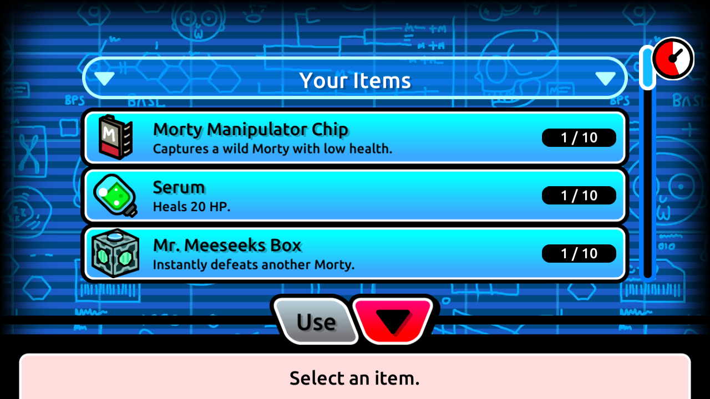
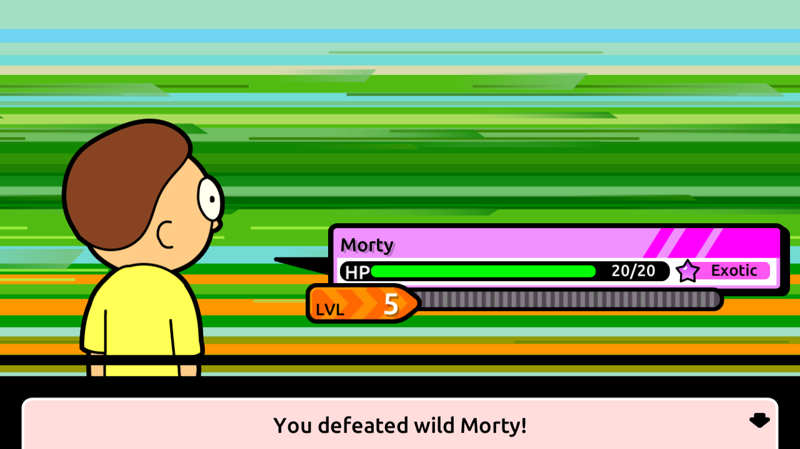

# Android Meeseeks Box acceptance

On November 7, 2026, Android 2.41.0 selected and used a Mr. Meeseeks Box through
the native battle bag against the isolated replacement server. The client
played the blue Mr. Meeseeks animation and displayed “You defeated wild
Morty!” The [sanitized acceptance receipt](android-meeseeks-box-results.json)
binds the on-device PCAP, reviewed screenshots, committed WIN and exact
restoration of the original guarded rows. This accepts the narrow
[PvWM contract](meeseeks-box-contract.md) on that replacement service.






The PCAP contains exactly one native `POST /session/battle/move` with
`session_id`, `battle_id`, `type`, `owned_morty_id` and `move_id`. Its ITEM actor
is the fixture's active owned clone and its item is `ItemMrMeeseek`. Exact TCP
ACK pairing proves HTTP 200 with `{success: true}`; Android headers and the
session hash match the guarded case. The durable private result contains one
successful ITEM action, defender HP zero, empty attacker snapshots and no AI
action. Stock changes from one box to an absolute zero. Owned HP remains
20/20, and owned AP, status, resources and original gameplay/history rows are
unchanged. The public wild removal and private WIN event pass the fixture
verifier; cleanup and a separate verification restore the original rows
exactly.

The first November 7, 2026 attempt displayed the box in the native Android bag,
but its battle timer expired before item use. The fixture verifier recorded
zero Meeseeks uses; guarded cleanup reported acceptance false and verified
the original rows exactly. That attempt supplies no native ITEM or successful
acceptance evidence. The successful receipt and screenshots above come from a
fresh second fixture and capture.

The bounded runtime uses the dedicated startup Android 2.41.0 AVD and the
isolated replacement service. `meeseeks_box_fixture.py` prepares a full-stat
owned clone, adds one temporary box, inserts a private wild spawn, and starts
the battle through synthetic HTTP setup. The second run captured 210 seconds
with screenshots every three seconds; its reviewed frames are the bag at
105 seconds, the Meeseeks animation at 114 seconds and victory at 123 seconds.
Item selection and Use occurred through the Android bag UI. Server HTTP
logging supplies an independent request/result comparison; it alone does not
prove Android provenance.

The encounter is a synthetic private spawn using the replacement server's
placeholder wild stats. This run does not validate natural encounter
generation, original wild stats, original-server consumption or initiative,
reward behavior, or any battle type beyond PvWM. The completion carries empty
rewards, XP and attacks-to-learn arrays. The receipt makes no original-service
parity claim.

Keep raw PCAPs, unreviewed screenshots, server log bodies, account identifiers
and fixture snapshots under ignored `.research/`. Only the sanitized receipt
and three reviewed, byte-for-byte screenshots are checked in. Their hashes
match the private review and acceptance receipt.

Reproduction requires the retained dedicated startup AVD on emulator 5560,
ADB server 5038, its verified installed diagnostic APK, and a fresh isolated
`offline-sdk-web` instance on host port 8091. The existing offline SDK helper
preserves app data and consent while routing device ports 8087/8089 to that
instance and denying external SDK traffic. It refuses a reused SDK probe
instance. Use fresh output directories and run the capture in another terminal
before launching the app:

```powershell
$researchPython = 'C:/Users/iantr/AppData/Local/Python/pythoncore-3.14-64/python.exe'
$adb = Join-Path $PWD '.research/emulator/sdk/platform-tools/adb.exe'
& $researchPython -X utf8 tools/research/startup_capture_device.py launch --role primary
& $adb -P 5038 -s emulator-5560 shell am force-stop com.turner.pocketmorties
docker compose -f compose.research.yaml --profile offline-sdk up -d --no-deps --force-recreate offline-sdk-web
& $researchPython -X utf8 tools/research/meeseeks_box_fixture.py preflight `
  --output .research/ANDROID-RUN/fixture
& $researchPython -X utf8 tools/research/meeseeks_box_fixture.py prepare `
  --output .research/ANDROID-RUN/fixture
& $researchPython -X utf8 tools/research/prepare_offline_sdk_device.py `
  --role primary --output .research/ANDROID-RUN/preparation

& $researchPython -X utf8 tools/research/capture_shared_startup.py `
  --role primary --duration 210 --screens 3 --output .research/ANDROID-RUN/capture
```

After capture starts, launch the retained app in another terminal with
`& $adb -P 5038 -s emulator-5560 shell monkey -p com.turner.pocketmorties -c android.intent.category.LAUNCHER 1`.
Use Multiplayer, dismiss the existing tutorial overlays, and wait for refreshed
player details before starting the fixture battle. Start and use the box promptly so the battle's move timer does
not expire. The helper sends only the synthetic spawn/start setup. On the 1280 by 720
research display, select ITEM at `(510,566)`, wait for the bag transition to
finish, select the box's third row at `(580,454)`, then Use at `(565,580)`.
The non-self item needs no party-target screen:

```powershell
& $researchPython -X utf8 tools/research/meeseeks_box_fixture.py start `
  --output .research/ANDROID-RUN/fixture

# After the native victory:
& $researchPython -X utf8 tools/research/meeseeks_box_fixture.py record `
  --output .research/ANDROID-RUN/fixture --label native-item
& $researchPython -X utf8 tools/research/meeseeks_box_fixture.py verify `
  --output .research/ANDROID-RUN/fixture
& $researchPython -X utf8 tools/research/meeseeks_box_fixture.py cleanup `
  --output .research/ANDROID-RUN/fixture
& $researchPython -X utf8 tools/research/meeseeks_box_fixture.py verify `
  --output .research/ANDROID-RUN/fixture
```

Preserve any failed or unexplained fixture for investigation. After the
bounded capture finishes, visually review its bag, animation and victory
frames and write the private screenshot review.

The private screenshot review document must bind the capture's PCAP hash and
reviewed screenshot hashes. Its fixed provenance fields are `private: true`,
`native_item_selection: true`, `battle_start: "synthetic-http"`,
`item_request: "native-ui"`, and `original_service_evidence: false`.
`screenshots` contains `{file, sha256, role, reviewed: true}` entries for
`bag-item-visible`, `item-animation`, and `terminal-win`. Every file must be
present in the capture manifest and must have been visually inspected.

```powershell
& $researchPython -X utf8 tools/research/sanitize_android_meeseeks.py `
  --fixture .research/ANDROID-RUN/fixture `
  --capture .research/ANDROID-RUN/capture `
  --review .research/ANDROID-RUN/screenshot-review.json `
  --label native-item `
  --output .research/ANDROID-RUN/android-meeseeks-box-sanitized.json

```

The exporter is read-only and fails closed on missing, mismatched or ambiguous
native operations, review evidence or restoration receipts. Cleanup evidence
must match the same case and recorded result, and the restored snapshot must
equal the original guarded rows. The public export contains role labels,
artifact hashes and status fields, with no account, session or battle IDs.

The five fixture guard tests and six packet/exporter tests pass (11 total):

```powershell
& $researchPython -X utf8 -m unittest discover -s tools/research -p test_meeseeks_box_fixture.py -v
& $researchPython -X utf8 -m unittest discover -s tools/research -p test_android_meeseeks_sanitizer.py -v
& $researchPython -X utf8 tools/research/validate.py
```

After both captures finished and exact cleanup passed, only the dedicated app,
its AVD and `offline-sdk-web` were stopped. The normal backend and other AVDs
were left running as found. This branch starts at PR #63 (`14149bc`); main was
inspected at `9ff1a11`. Gameplay PHP and schema are unchanged in this follow-up.
