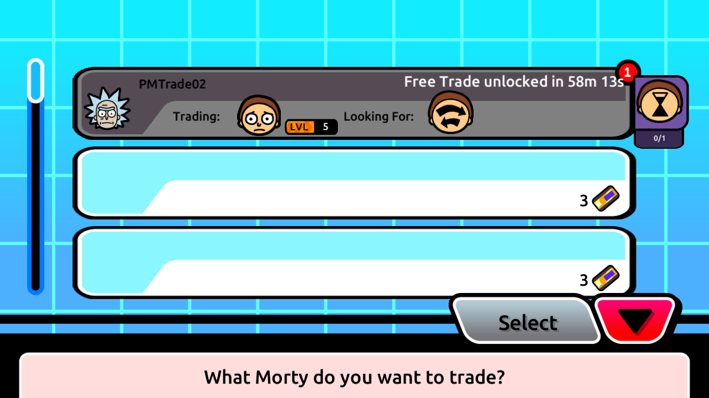
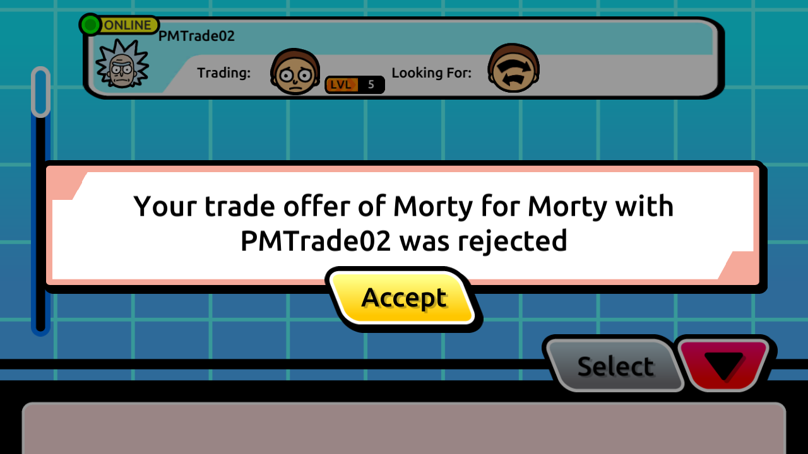
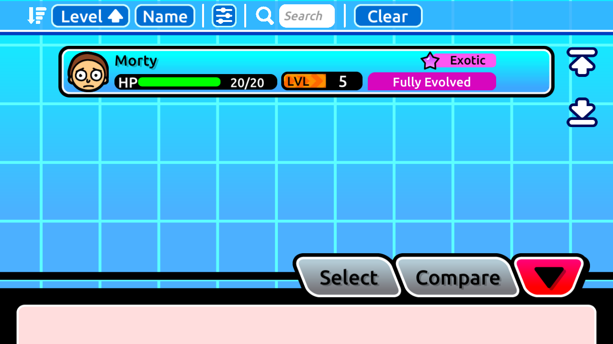
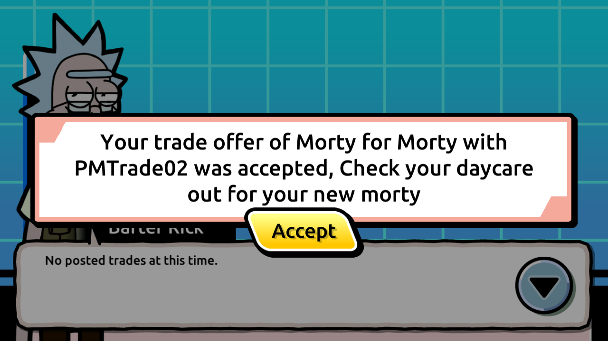

# Concurrent native trade refresh validation

Both retained Android clients now complete a native offer/rejection and a second
offer/acceptance while staying connected. Each counterpart notification is
followed by successful native trade-data and inventory refreshes. The offerer
receives the correct rejection/acceptance popups and can select its released
spare again after rejection without logging in or reopening the kiosk.
The [sanitized packet and database receipt](live-trade-refresh-results.json)
records the verified scope and its limitations.

The existing [refresh event contract](trade-refresh-event-contract.md), recovered
with REA 6.8.0 in the default WSL environment, supplies the bounded native
handler behavior. This document does not claim a new static trace. The earlier
[synthetic consumer smoke](trade-refresh-implementation.md) remains separate
from this real-mutation cycle. No gameplay endpoint or database schema changed
in this follow-up.

## Independent offline SDK fixtures

`compose.research-trade-pair.yaml` adds `offline-sdk-peer` by extending the
existing `offline-sdk-web` service. Its sole configuration difference is the
loopback host port: primary uses 8091 and peer uses 8093. Both expose the same
emulator-facing origin, `http://localhost:8087`, and the same application source,
database configuration, read-only bind mount, dependencies and offline-SDK mode.

The first SDK probe returns 503 and subsequent probes return 204 for each
container lifetime. The state file is
`/tmp/pocket-research-offline-sdk-once.json` inside each container. Separate
containers prevent preparation of a peer from resetting the primary's probe
state. Recreate only the sidecar that needs a fresh startup fixture; recreating
the primary sidecar while its client is active would interrupt that client's
session and invalidate an uninterrupted-cycle claim.

The overlay uses `ports: !override`, requiring Docker Compose 2.24.4 or newer.
Local read-only validation used Compose v5.6.0. Resolved configuration parity
was checked for build, environment, volumes, dependencies, profiles and
networks, with exactly one published port per sidecar and no port conflict.

## Reproduction

Use the retained `trade-primary` and `trade-peer` diagnostic clients, with their
installed APKs and private app data preserved. Start from the last accepted
pair's final guard, including the ownership exchange and retained completion;
do not reseed or restore the original ownership assumptions. The two spare
instances belong to their post-swap owners, and one earlier completion remains.

With the research backend already healthy, the peer-only startup command is:

```powershell
docker compose -f compose.research.yaml -f compose.research-trade-pair.yaml --profile offline-sdk up -d --no-deps --force-recreate offline-sdk-peer
```

For a fresh primary startup, recreate `offline-sdk-web` separately before that
client launches. Do not recreate either sidecar during the live cycle. The
preparation helper verifies that the selected container's state file is absent;
a used or unavailable fixture fails without resetting it. The `/time` health
request does not consume the SDK probe.

```powershell
$researchPython = 'C:/Users/iantr/AppData/Local/Python/pythoncore-3.14-64/python.exe'
$runRoot = '.research/emulator/live-trade-refresh-20261107'
& $researchPython tools/research/prepare_offline_sdk_device.py --role trade-primary --output "$runRoot/primary-preparation"
& $researchPython tools/research/prepare_offline_sdk_device.py --role trade-peer --instance peer --output "$runRoot/peer-preparation"
```

Every output must be fresh; these commands intentionally fail if the evidence
directory already exists. Use a new run root for a later reproduction. The
`--instance peer` option is accepted only with `--role trade-peer`. It maps both
device TCP ports 8087 and 8089 to host 8093. The default instance retains the
existing 8091 routing for every role. Preparation verifies retained package
identity, stops the app and establishes the existing external-traffic denial;
it does not reinstall the app, clear app data, edit consent, reset fixture state
or alter a save.

Begin both packet captures before native app startup so each stream's opening
HTTP headers and startup readiness can be associated with later SSE frames.
Run these in separate PowerShell sessions, then launch both retained clients
and perform the native UI actions within the capture windows:

```powershell
& $researchPython tools/research/capture_shared_startup.py --role trade-primary --duration 900 --output "$runRoot/trade-primary-live-capture" --screens 5
& $researchPython tools/research/capture_shared_startup.py --role trade-peer --duration 900 --output "$runRoot/trade-peer-live-capture" --screens 5
```

The capture helper's bounded maximum is now 900 seconds; its default remains
60 seconds. Both commands must be active concurrently, not executed serially
in one terminal. The longer window preserves continuous stream context through
navigation and both decisions. Raw PCAPs, logs, identities and snapshots remain
private under `.research`. Only selected synthetic-account screenshots are
published below.

The pure preparation suite requires no Docker, ADB or network operations:

```powershell
& $researchPython tools/research/test_paired_offline_sdk_prepare.py
```

All eight tests passed. They cover independent peer routing, default behavior
for every role, invalid instance/role rejection, used or unavailable fixture
failure, health failure, existing-evidence preservation and the preparation
record's no-reinstall/no-clear/no-consent-edit/no-probe-reset flags.

## Observed cycle and evidence boundaries

Private evidence for this attempt is rooted at
`.research/emulator/live-trade-refresh-20261107`. Initial 180-second startup
captures in `trade-primary-startup-capture` and `trade-peer-startup-capture`
contain no running game apps. They are retained bootstrap diagnostics and are
excluded from proof input. The later `trade-primary-live-capture` and
`trade-peer-live-capture` recordings ran continuously for approximately 679
seconds within their 900-second bounds. After the native lifecycle completed,
the two specifically verified tcpdump processes received SIGINT to flush and
finalize cleanly. Both manifests have no failure; their actual start/end times
and private graceful-stop receipts are retained. Neither game nor SSE connection
was restarted during the cycle.

The fixture baseline is anchored to the last accepted final guard, with no
reset of saves, ownership, completion history or fixture economics. Baseline
and final read-only snapshots must distinguish this cycle's changes from the
prior completed swap.

PMTrade02 posted a free `any`/`Normal` request using its current non-party spare.
PMTrade01 offered its spare. Without a requester kiosk reload, an incoming-offer
badge appeared and its captured `trade:offer-submit` caused GetTradeData and
GetDetails(`0x78`). PMTrade02 rejected the offer through the native menu.
PMTrade01's `trade:offer-rejected` caused the same two refreshes and the native
**was rejected** popup. Its spare was visible in the selection list immediately
after acknowledging that notification; no new login or kiosk reload occurred.

PMTrade01 offered that spare again on the same retained parent. The second
`trade:offer-submit` refreshed PMTrade02, which selected **Accept** in the native
decision menu. The requester displayed **Trade Successful**. The offerer received
`trade:offer-accepted`, refreshed both interfaces, and displayed **was accepted**
without reconnecting. Popup acknowledgement was recorded separately from the
actual decision. No scripted trading API request or synthetic event substituted
for a gameplay action in this cycle.






Five append-only observations preserve the parent, first offer, rejection,
second offer and acceptance. Rejection removed only its offer. Acceptance swapped
exactly the two current spares, removed the parent/offer and added one completion
while preserving the previous completion (two total). Active starters/decks,
stats, attacks, items, balances, friendship and stored flags were unchanged.
The new free-trade expiry was written only at parent creation and retained.
Notification revisions ended at PMTrade01=3 and PMTrade02=2: each committed
offer/decision updated its counterpart only. Both accepted inventory responses
match the post-swap database and boolean lock values.

The original-account, startup-save and final trading-pair guards passed. Installed
diagnostic APK hashes were unchanged. Only the verified trading AVDs and their
two SDK sidecars were stopped; userdata and both completions were retained. The
new final guard supersedes the older owner-bound accepted-state guard; do not
restore old ownership or replay setup scripts.

The proof binds exact HTTP IDs, sessions, native headers and login cookies to
the database chain. Empty SSE bodies contain no trade ID, so their correlation
is by device-local phase and recipient revision, not a claimed ID carried in
the frame. Each device retains its own packet clock. No cross-device/server
clock alignment or mutation-to-SSE latency is inferred. The startup configuration
request's observed null `session_id` is treated separately; mutations and live
refreshes require the current session and native trading cookie.

Both clients used the same world; cross-room delivery and a native third-account
privacy scenario are not newly established. Existing backend privacy/reconnect
tests remain separate. Immediate self-cancellation unlock, request-creation and
cancellation fanout, iOS, legacy stored locks and original-server semantics
remain open. Synthetic generated stats do not establish original gameplay formulas.

## Checks and packet-proof reproduction

All 26 new pure cases pass: 8 preparation, 8 append-only fixture and 10 packet-proof
tests. The six existing native-smoke parser cases also pass. No database suites
ran while the clients were active. Research JSON/source-hash validation and
incremental whitespace checks passed; root README claims/attribution and the
original SQL dump were unchanged.

```powershell
& $researchPython -X utf8 -m unittest discover -s tools/research -p test_paired_offline_sdk_prepare.py -v
& $researchPython -X utf8 -m unittest discover -s tools/research -p test_live_trade_refresh_fixture.py -v
& $researchPython -X utf8 -m unittest discover -s tools/research -p test_live_trade_refresh_sanitizer.py -v
& $researchPython -X utf8 tools/research/sanitize_live_trade_refresh.py `
  --primary-pcap "$runRoot/trade-primary-live-capture/trade-primary-http.pcap" `
  --peer-pcap "$runRoot/trade-peer-live-capture/trade-peer-http.pcap" `
  --parent "$runRoot/fixture/observe-parent-created.json" `
  --offer "$runRoot/fixture/observe-offer-created.json" `
  --rejected "$runRoot/fixture/observe-offer-rejected.json" `
  --accept-offer "$runRoot/fixture/observe-second-offer-created.json" `
  --accepted "$runRoot/fixture/observe-offer-accepted.json" `
  --output "$runRoot/reproduced-live-proof.json"
```

The observer is read-only. Its initial snapshot requires the fixed immutable
accepted-state anchor, and its live observations reject unresolved attempts,
failed receipts, protected drift and unexpected notification targets. The
sanitizer revalidates that entire baseline/hash chain before emitting allowlisted
facts. Private captures/anchors are required to reproduce this retained run;
another pair must use its own independently guarded setup.
