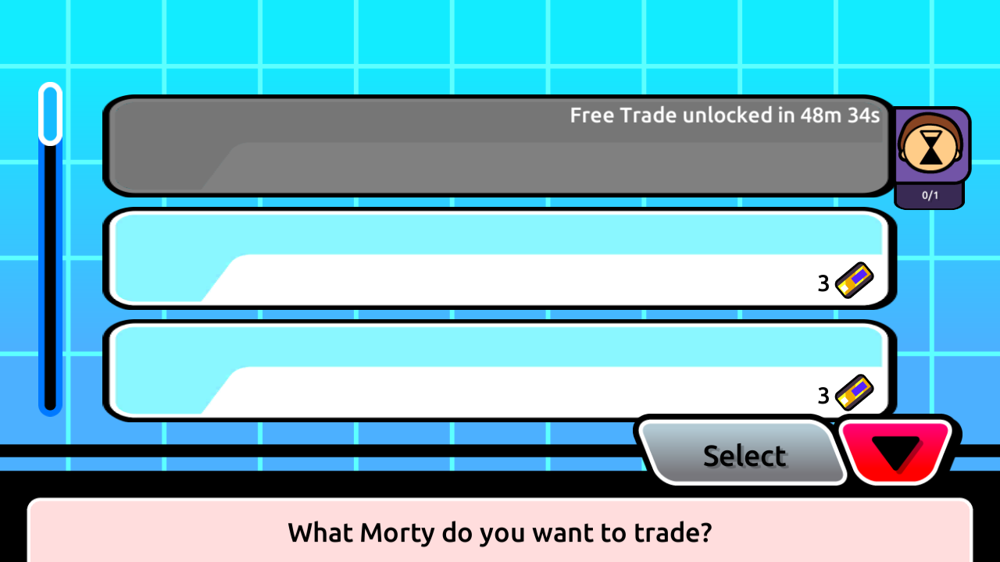
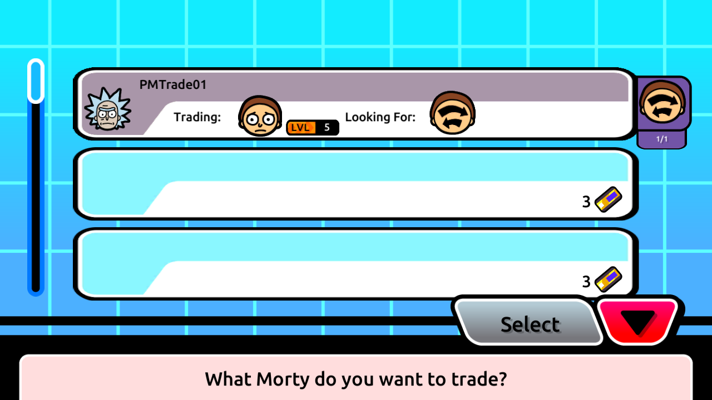

# Native request cancellation and stored cooldown repair

Android 2.41.0 now completes an observed own-request lifecycle on the isolated
backend: choose an unlocked spare outside the active party, create a free request
for any Morty, inspect it and press Cancel. Both mutations returned 200. The
listing disappeared, and native player-details responses carried the spare's
trading lock as Boolean `true` after creation and `false` after cancellation.
The [sanitized proof](native-trade-cancellation-results.json) links the exact
request/response pairs, private database snapshots and reviewed screenshots.

This verifies one own-request path on the replacement server. Offer creation,
offer cancellation, acceptance and transfers remain separate. No original-service
traffic or original economic rules are claimed.

## Confirmed repair

The successful native cancellation exposed a read defect. The database retained
the future `users.expiry_trade` written by free creation, but `/trading/get-trades`
returned `player_cooldown_data: {expiry: null, trades: 0}`. Its authentication
query selected only `player_id`, then the projection tried to read an unselected
`expiry_trade` field. The fallback always discarded the stored cooldown.

The query now selects `player_id, expiry_trade` from the authenticated session's
row. Existing projection fields and types are retained. No timestamp is generated,
renewed, cleared or reformatted by this repair; NULL still yields null/zero.
Cancellation still preserves the existing expiry. A spoofed body `player_id`
does not choose another account's cooldown.

| Evidence | Before repair | After repair |
| --- | --- | --- |
| Native GetTrades | null expiry / integer zero despite stored expiry | Exact stored expiry / integer one |
| Native free slot after data refresh | Appeared available after cancellation | Disabled with remaining-time countdown |
| Database cancellation side effects | Listing removed; expiry/resources preserved | Same listing-only mutation policy |



The full native create/cancel capture precedes the query repair. A separate native
exit/reentry capture proves the repaired GetTrades response matches the **same**
retained expiry, and manual screenshot review proves the disabled slot/countdown.
Do not present these as a second native creation/cancellation cycle after repair.

## Disposable account and data provenance

This run created new userdata for `PocketMortys_API30_Trading` on emulator-5564,
ADB 5038. Native registration created synthetic account `PMTrade01`. The installed
ARM32 diagnostic APKs match the existing signed inputs and retain prior local
transport/multiplayer-unlock probes; no trading method was patched. ARM64 static
analysis comes from the original client, as recorded in the
[creation contract](native-trade-creation-contract.md).

The registration party contains one starter. The isolated CLI fixture copied that
account's own complete starter row and attack into one additional owned instance,
changing only its instance UUID and automatic row IDs. It did not invent stats,
PP, evolution rules or rewards. The spare remains outside all decks. Native
selection displayed exactly that one eligible spare, while the active starter
was excluded. Both copies remain preserved in the disposable account after the
test; collection-preservation comparisons use the prepared two-Morty baseline.


`native_trade_fixture.py` requires the exact isolated CLI database environment and
unique PMTrade01 identity. Preparation holds the owner's row, verifies pristine
registration values and global absence of the new UUID, then copies both rows in
one transaction. It refuses a second preparation. Coherent snapshots retain full
scoped private rows, including credentials, under ignored `.research`; they must
not be published. Attempt markers prevent automatic retries after an interrupted
commit. No account deletion, global seed or data reset is part of this fixture.

## Native sequence and persistence

The [bounded creation trace](native-trade-creation-contract.md), recovered with
REA 6.8.0, establishes the two independent lock filters, active-deck exclusion,
first/free slot and default `any`/`Normal` selection. The actual device followed
the [verified kiosk route](trading-kiosk-reachability.md), completed its first-use
tutorial, opened Trade and selected the first slot and synthetic spare.



| Operation | Observed contract |
| --- | --- |
| Create | POST `/trading/request-morty`; exactly session, player, owned-instance and desired-species IDs, variant string and Boolean `is_free_trade: true` |
| Creation refresh | Successful player details; complete known inventory, spare `is_trading_locked: true`, manual lock false |
| Cancel | POST `/trading/cancel-trade`; exactly `{trade_id}`, authenticated by the native cookie matching creation's session |
| Cancellation refresh | Successful player details requested after cancellation response; spare trading lock false, manual lock false |
| Post-fix reload | Native GetTrades; empty listing arrays, exact persisted expiry and integer cooldown count one |


The packet decoder verifies complete Content-Length bodies, consistent contiguous
TCP data and exact response acknowledgement pairing. It requires the final
inventory **request**, as well as its response, to follow cancellation's response;
a previously issued request with a delayed response is rejected. The real capture
satisfies this stronger ordering. Returned trade identity/selection fields match
the captured database row; `_created` is not claimed to equal the SQL timestamp.

Database request counts progressed `0 → 1 → 1 → 0 → 0` across before-create,
created, before-cancel, cancelled and verification snapshots. Decks, Morties,
attacks, items, coupons, ownership and raw lock flags stayed identical to the
prepared baseline. Free creation alone added the persisted expiry; cancellation
and subsequent reload retained it. No offers or completed transfers appeared.

## Reproduction

Use a fresh dedicated trading installation and isolated database state for the
one-time native registration/preparation. Existing PMTrade01 and receipt files
must be preserved rather than deleted to replay this procedure. The helpers also
reserve `trade-peer`/5566 for later offer testing; no peer was launched here.

```powershell
$researchPython = Join-Path $env:LOCALAPPDATA 'Python\pythoncore-3.14-64\python.exe'
& $researchPython -X utf8 tools/research/startup_capture_device.py launch --role trade-primary
& $researchPython -X utf8 tools/research/startup_capture_device.py status --role trade-primary
# Wait for Android boot/PackageManager before the first installation.
& $researchPython -X utf8 tools/research/startup_capture_device.py install --role trade-primary
```

Follow [isolated SDK startup](onetrust-startup-recovery.md) using role
`trade-primary`, a fresh service lifetime and fresh preparation/capture outputs.
Decline optional Play Games installation, complete the native first-run terms
screen and register PMTrade01 through Multiplayer. Stop only this dedicated app
before preparing its spare. Do not clear app data, reinstall over its save or
edit SDK consent/cache files. A separate retained-client reload uses another
fresh one-shot service lifetime; preserve previous captures and counters' receipts.

```powershell
& $researchPython -X utf8 tools/research/native_trade_fixture.py snapshot --output .research/native-trade-next/fixture
& $researchPython -X utf8 tools/research/native_trade_fixture.py prepare --output .research/native-trade-next/fixture
# Reload this client normally to fetch the spare, then navigate to the kiosk.
& $researchPython -X utf8 tools/research/capture_shared_startup.py --role trade-primary --duration 180 --screens 5 --output .research/native-trade-next/request-cancel-capture
```

Run `observe --output <fixture> --label <label>` immediately before creation,
after creation, before cancellation and after cancellation. Required labels for
the sanitizer are `before-create`, `request-created`, `before-cancel`, and
`request-cancelled`. Finish with `verify-cancelled --output <fixture>`. Capture
before pressing Confirm/Cancel. Use a new capture for the repaired cooldown read.

```powershell
& $researchPython -X utf8 tools/research/sanitize_native_trade_cancellation.py --pcap .research/emulator/native-trade-cancellation-20261106/request-cancel-capture/trade-primary-http.pcap --fixture-dir .research/emulator/native-trade-cancellation-20261106/fixture --cooldown-pcap .research/emulator/native-trade-cancellation-20261106/cooldown-repair-capture/trade-primary-http.pcap --output .research/native-trade-proof-next.json
wsl.exe -- bash tools/research/ghidra-trade-creation.sh
& $researchPython -X utf8 -m unittest discover -s tests/protocol -p test_trade_cooldown.py -v
& $researchPython -X utf8 tools/research/test_native_trade_cancellation_sanitizer.py -v
& $researchPython -X utf8 tools/research/test_trade_device_isolation.py -v
& $researchPython -X utf8 tools/research/validate.py
```

The sanitizer outputs allowlisted booleans, field names, counts, packet indices
and whole-input hashes. Unexpected identities, shapes, cookie/session mismatch,
lock types, packet ordering or cooldown values reject the proof without exposing
parser exception contents.

## Verification and limits

Forty backend cases passed serially: 3 new cooldown cases, 19 cancellation,
12 durable-reference and 6 trade-party guards. The new suite reproduced three
failing assertions before the query fix; NULL/read-only checks already passed.
Seven pure cases passed: 4 proof-sanitizer and 3 device/path-isolation cases.
An independent review caught the earlier-request/later-response ambiguity; its
new rejection subcase failed before the stronger check and passed afterward.
The actual capture passed again with the stronger check. PHP handler and embedded
fixture syntax, Python, shell, source evidence and screenshot hashes passed.
Whitespace checks allow the existing PHP CRLF line endings.

Both original-account guards and the retained startup/history guard passed.
Final disposable-account checks retained its prepared collection, resources and
expiry, and installed APK hashes still matched the diagnostic inputs. Only
verified emulator-5564 and the optional SDK sidecar were stopped; userdata and
private evidence remain retained. No migration, merge or deployment is included.

Native offer creation/cancellation, acceptance authorization and request/offer
binding, broader serializers and legacy true flags remain open. The captured
creation response omits `cooldown`; this narrow cycle succeeded, but broader
creation-cache compatibility remains a separate gap. Server-side enforcement of
free-slot availability is also separate from this projection repair. Existing
creation duration, configured duration and premium-price discrepancies are not
resolved here; no original refund, price or cooldown formula was inferred.

Branch `hayward/native-trade-cancellation` starts from main `9ff1a11`, explicitly
fast-forwarding PR #52 at `f9eea01`. The repair is `3402ba2`, fixture/proof tools
are `9031d2f`, and stricter proof ordering is `6fed404`. Root README features and
attribution remain unchanged relative to the prerequisite.
