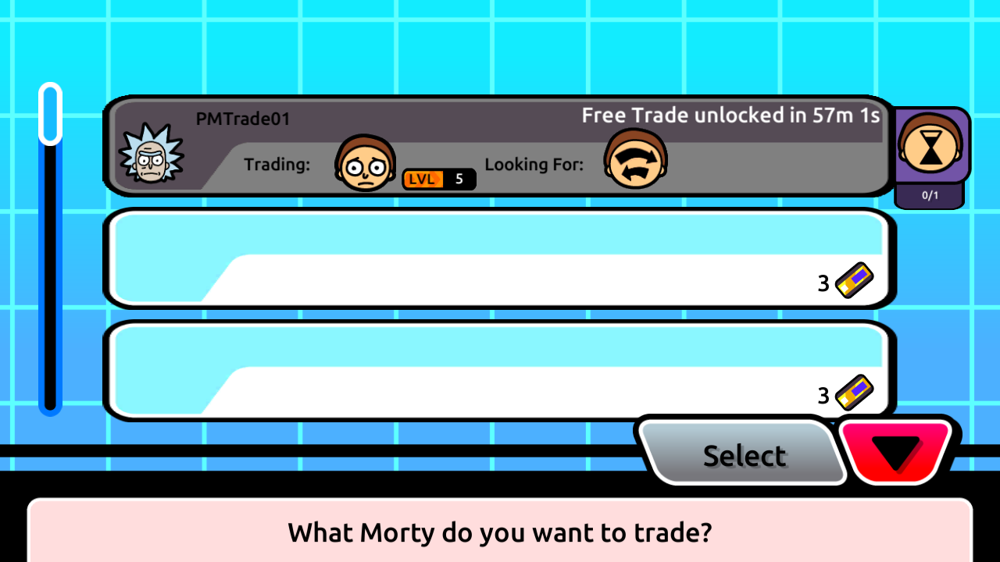
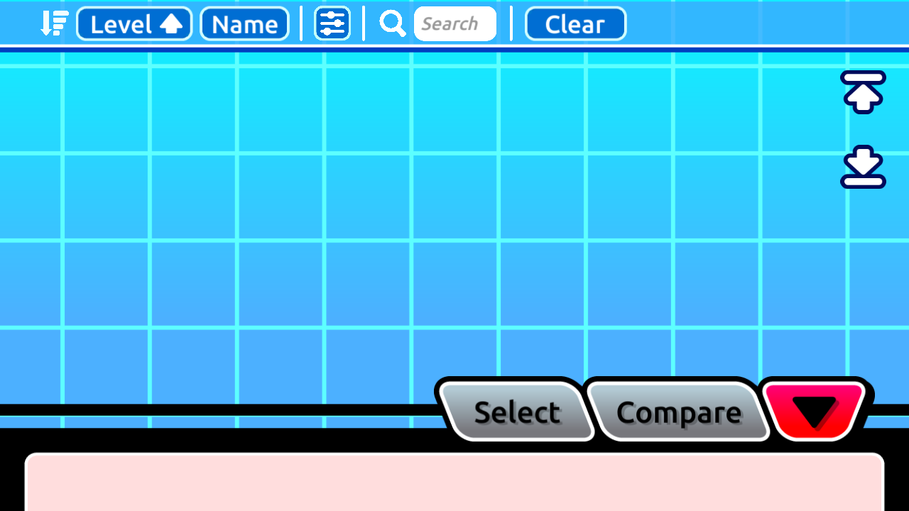
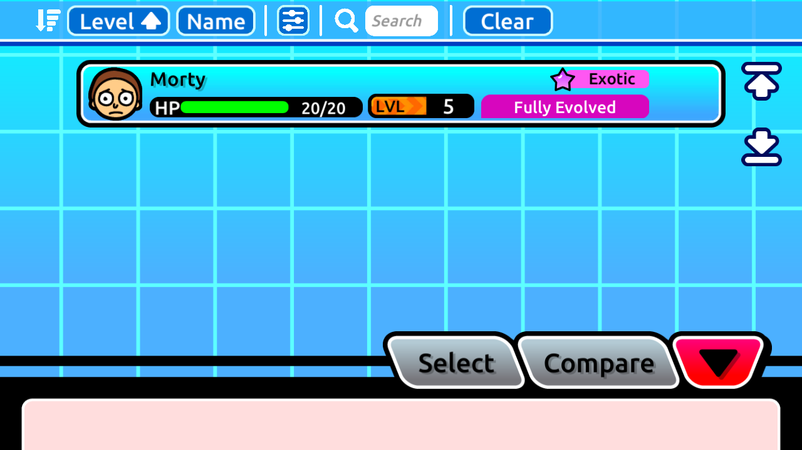
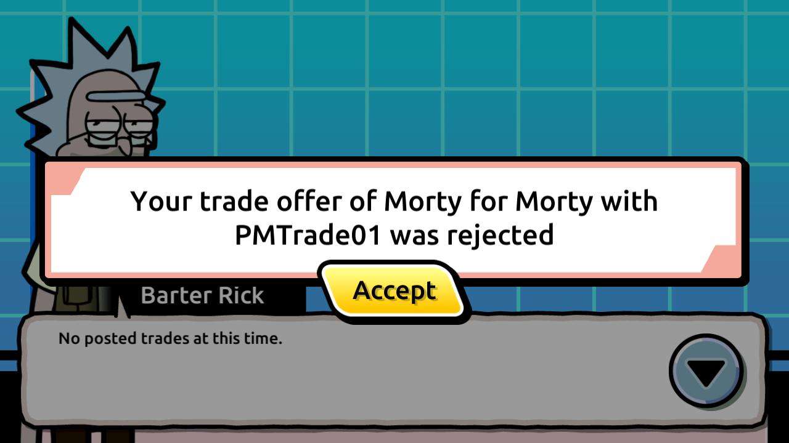

# Counterpart refresh after trade cancellation

Successful listing cancellation now publishes the existing native trade
invalidation to the affected counterpart in the same transaction as deletion.
The one-ID request bodies, cookie/Bearer authentication and HTTP responses from
[owner-scoped cancellation](trade-cancellation-implementation.md) are unchanged.
This extends [trade refresh delivery](trade-refresh-implementation.md), using
its existing migration 015 storage and startup gate; no new migration is needed.

## Publication policy

| Committed cancellation | Recipient | Event |
| --- | --- | --- |
| Own offer withdrawal with a surviving parent | Current locked parent owner | `trade:offer-submit` |
| Own request removal with dependent offers | Distinct removed offer owners | `trade:offer-rejected` |
| Orphan offer withdrawal | None | None |
| Request removal without dependent offers | None | None |

The actor is excluded by exact player identity. Multiple removed offers from
one account produce one revision. Blank or otherwise non-deliverable stored
owners are skipped so their legacy rows can still be withdrawn. A self-owned
child produces no actor notification. No friendship or room-wide audience is
introduced. This is replacement recipient policy; original-service audiences
and cancellation/refund economics remain unknown.

`lib/trade_cancellation.php` selects recipients from the locked rows it actually
removes, then calls `trade_refresh_publish` before commit. The publisher sorts
and deduplicates recipient identities without locking their user rows. A
publication failure rolls back every deletion and notification. Authentication,
ownership, missing-listing, malformed-body and ambiguity failures publish
nothing; retries after a successful removal do not increment a revision.

Parent cancellation scans locked dependent rows and rejects a case or
trailing-space alias of the parent identifier with 409. Deletion uses the
validated physical row IDs, checks the affected-row count, and preserves
unrelated listings. Ownership, stats, attacks, stored lock flags, decks,
inventory, balances, friendships, cooldowns and completed-trade history are not
changed by cancellation. A remaining durable reference can still keep an
instance reserved; this does not reconcile unknown legacy lock flags.

## Native actor limitation

All four [recovered handlers](trade-refresh-event-contract.md) reload
GetTradeData and GetDetails(`0x78`) with an empty event payload. The submit event
therefore also serves as an invalidation when an offer disappears; its name
does not encode an accepted/rejected outcome.

The cancelling actor is intentionally excluded. Its offer-cancel success
callback removes saved offer history without refreshing owned details. An
independent refresh can race that cleanup and cause a false rejection
notification. The [fresh bounded audit](trade-cancellation-refresh-contract.md),
including the local/platform-cloud Save path, did not establish an ordering-safe
way for PHP to refresh the actor after its saved-history
cleanup. Immediate actor-side inventory unlock remains open; no arbitrary
delay, fabricated completion or raw-flag change is introduced. This is a
bounded finding about the inspected paths, not proof that every solution is
impossible.

## Backend verification

The new 15-case `test_trade_cancellation_notifications.py` uses additive UUID
fixtures on the isolated research stack. The initial two target cases failed
before publication was added; all 15 now pass. They cover exact counterpart
audiences/revisions, sibling deduplication, actor exclusion, current parent
ownership, no-child and orphan removal, malformed and collated aliases,
undeliverable legacy owners, retries and rollback after publisher failure,
including failure on the second recipient.

The adjacent 50 cases also pass: 19 cancellation, 12 durable-reference,
15 refresh and four offer-metadata cases. The cancellation observer has nine
pure tests. These results establish replacement backend behavior; native
cancellation-triggered delivery is verified separately below.

Run exact modules serially with game apps stopped, after applying migration
015. Broad discovery includes an older suite that reseeds global accounts.

```powershell
$researchPython = 'C:\Users\iantr\AppData\Local\Python\pythoncore-3.14-64\python.exe'
$modules = @('test_trade_cancellation_notifications.py', 'test_trade_cancellation.py',
  'test_trade_references.py', 'test_trade_refresh_events.py', 'test_trade_offer_metadata.py')
foreach ($module in $modules) {
  & $researchPython -X utf8 -m unittest discover -s tests/protocol -p $module -v
  if ($LASTEXITCODE -ne 0) { exit $LASTEXITCODE }
}
& $researchPython -X utf8 -m unittest discover -s tools/research -p test_cancel_trade_refresh_fixture.py -v
& $researchPython -X utf8 tools/research/validate.py
```

## Native cancellation validation

Both cancellation phases now pass the
[strict native packet/database proof](trade-cancellation-refresh-results.json).
The earlier [live rejection/acceptance cycle](live-trade-refresh.md) remains
separate evidence. Its immutable final guard retains two completions, no parent/offers,
PRIMARY revision 3 (`trade:offer-accepted`) and PEER revision 2
(`trade:offer-submit`). The cancellation observer uses this exact accepted
ownership/party state without preparing or resetting the accounts.

The observed roles reverse the prior cycle: PMTrade01/PRIMARY creates a free
parent only after its old cooldown naturally expires; PMTrade02/PEER offers its
current owned spare. The peer withdraws its first offer, then deliberately
cold logs in before creating a second offer. The primary cancels the parent.
The peer restart separates capture phases and must not be described as an
uninterrupted two-client session. Each phase uses native input and independent
offline-SDK sidecars; no stale-inventory bypass substitutes for cold login.

The primary stayed connected throughout. After peer offer withdrawal, its
incoming badge cleared without reopening the kiosk. Captured
`trade:offer-submit` triggered GetTradeData and GetDetails(`0x78`); the parent
remained, with its own Morty still correctly reserved. The peer received no
actor event or new owned-details response after cancelling its offer. Its
selector remained empty, reproducing the self-cancellation gap rather than
claiming to repair it.

After the explicit peer cold login, startup details returned the spare unlocked
and the selector showed it again. The peer offered it a second time. The primary
selected **Cancel** in the incoming-offer management screen, sending the native
one-field `/trading/cancel-trade` request. The peer received
`trade:offer-rejected`, refreshed trade data and owned details, and displayed
**was rejected**. The peer's refreshed lock flags were false; the primary's
own cancellation callback also fetched unlocked owned details. UI wording and
selector availability are manual screenshot observations, separate from the
packet checker's deliberately bounded flags.






The primary's continuous capture ended normally at its 900-second bound, after
the parent cancellation and its details response. The two peer recordings were
finalized with SIGINT sent only to their verified tcpdump processes. Their
separate login/SSE sessions are explicitly validated, never stitched into an
uninterrupted peer session. No scripted gameplay API request or synthetic
notification replaced a native action.

The final guard has zero requests/offers and both previous completions unchanged.
No ownership, party, stat, attack, item, balance, friendship or stored-lock change
occurred. The primary's new expiry was set only by native free creation and
retained after both cancellations. Notification revisions ended PRIMARY=6 and
PEER=3. Original-account/save guards and both installed APK hashes passed; only
the trading AVDs and their SDK sidecars were stopped, retaining userdata.

An initial checker rejected a legitimate asynchronous startup config request:
its body still held null `session_id`, with the current native cookie, even
though initial details had already completed. The corrected startup-only guard
requires the exact null shape before the first join or non-config trading
operation; all mutation/refresh session checks remain unchanged. The failed
diagnostic is retained, and no capture row was omitted from the final proof.
Capture clocks remain independent; empty SSE bodies are correlated by phase,
HTTP identities and recipient revisions, not by a trade ID in the frame or a
claimed cross-clock latency.

Create an append-only read-only baseline in a fresh private directory:

```powershell
$output = '.research/emulator/trade-cancellation-refresh-20261107/<fresh-run>'
& $researchPython -X utf8 tools/research/cancel_trade_refresh_fixture.py snapshot `
  --anchor .research/emulator/live-trade-refresh-20261107/final-guard.json --output $output
```

After the corresponding native action, capture each stage with `observe`:

| Label | Stage | Required notification state |
| --- | --- | --- |
| `parent-created` | `parent` | PRIMARY 3 / PEER 2 retained |
| `first-offer-created` | `offer` | PRIMARY 4 submit / PEER 2 retained |
| `offer-cancelled` | `offer-cancelled` | PRIMARY 5 submit / PEER 2 retained |
| `second-offer-created` | `offer` | PRIMARY 6 submit / PEER 2 retained |
| `parent-cancelled` | `parent-cancelled` | PRIMARY 6 retained / PEER 3 rejected |
| `final-guard` | `parent-cancelled` | Same terminal state; no new publication |

```powershell
& $researchPython -X utf8 tools/research/cancel_trade_refresh_fixture.py observe `
  --output $output --label parent-created --stage parent
```

The observer imports the existing SELECT-only consistent-snapshot capture,
including notification rows in the same read-only transaction. It permits
bounded session/room/presence dynamics and the new primary parent's one-hour
expiry, retained after cancellation. All physical inventory rows and both old
completion records remain exact; ownership never swaps. Failed observations
halt the hash-linked chain. Private captures, credentials and raw receipts
remain ignored. The two old completions, unchanged ownership and exact
notification deltas were verified at every stage.

Reproduce the read-only packet proof with the retained private inputs and a fresh
output. The peer restart is represented by two separate captures:

```powershell
$runRoot = '.research/emulator/trade-cancellation-refresh-20261107'
& $researchPython -X utf8 tools/research/sanitize_trade_cancellation_refresh.py `
  --primary-pcap "$runRoot/primary-live-capture/trade-primary-http.pcap" `
  --peer-first-pcap "$runRoot/peer-withdrawal-capture/trade-peer-http.pcap" `
  --peer-second-pcap "$runRoot/peer-parent-cancel-capture/trade-peer-http.pcap" `
  --parent "$runRoot/fixture/observe-parent-created.json" `
  --offer "$runRoot/fixture/observe-first-offer-created.json" `
  --offer-cancelled "$runRoot/fixture/observe-offer-cancelled.json" `
  --second-offer "$runRoot/fixture/observe-second-offer-created.json" `
  --parent-cancelled "$runRoot/fixture/observe-parent-cancelled.json" `
  --output "$runRoot/reproduced-native-proof.json"
```

The final targeted run passed 101 cases: 65 backend tests, 9 observer tests,
10 cancellation-proof tests, 11 adjacent live-proof tests and 6 existing smoke
parser tests. PHP lint, research validation and whitespace checks pass. Root
README and original SQL dump remain unchanged. There is no new migration or
production deployment. Immediate self-cancellation unlock, iOS, native
third-account privacy and cross-room cancellation delivery remain separate gaps.
