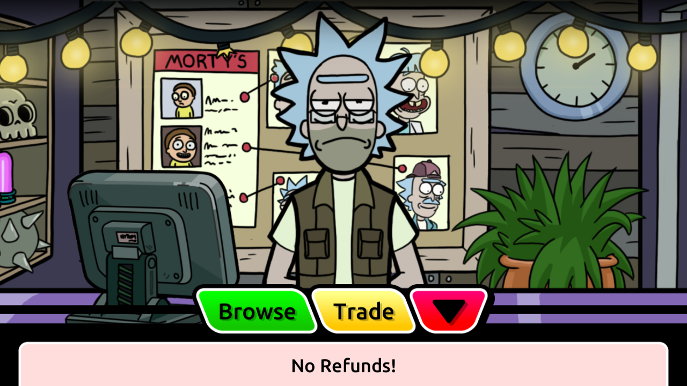

# Trading kiosk reached on retained Android 2.41.0

The retained diagnostic Android client now opens the Swap Stop, displays Barter
Rick's trading menu and Trade slots, and reports no posted trades under Browse.
The earlier bounded navigation failure is superseded for kiosk reachability by
this observation. Native cancellation and nonempty listing flows remain untested.
No game PHP, schema, account collection, trade listing or gameplay formula was
changed to reach this screen.

The [sanitized receipt](trading-kiosk-results.json) records the captures, reviewed
screenshots and preservation checks. This is replacement-server compatibility
evidence; it does not establish original-service behavior.



## Placement and interaction

The [native trace](trading-kiosk-native-contract.md) establishes that the client
loads a dimension resource, initializes its `Nodes` components and selects an
interaction through a facing raycast. The [placement export](trading-kiosk-placement.json)
then links ResourceManager entries for all seven multiplayer dimensions to their
original APK serialized carriers. Each contains one active `MPTradeKiosk` under
active ancestors and one active direct `InteractionPoint` on layer 8, with an
enabled non-trigger BoxCollider. These match the recovered raycast requirements.

This placement comes from original `base.apk`, SHA-256
`b44f255bdd58b3196d73ff811c3e645d68edcbd76366a39f5c4489bc538ebf74`,
using UnityPy 1.25.0. It is separate from external `appdata`/`mpdata` bundle
provenance. The world prefab is embedded in the APK; a separate server-spawned
kiosk record was not needed for the observed interaction.

| Dimension resource | Serialized kiosk position X/Z | Serialized interaction point X/Z |
| --- | --- | --- |
| MPDimension1 | 15.831 / 62.440 | 12.441 / 62.520 |
| MPDimension2 | 53.033 / 44.400 | 49.483 / 44.480 |
| MPDimension3 | 58.500 / 54.430 | 55.517 / 54.510 |
| MPDimension4 | 9.210 / 26.430 | 6.474 / 26.510 |
| MPDimension5 | 54.080 / 26.470 | 50.580 / 26.550 |
| MPDimension6 | 58.876 / 51.854 | 55.499 / 51.934 |
| MPDimension7 | 70.223 / 36.402 | 67.487 / 36.482 |

These are positions composed within each serialized prefab, rounded here only
for reading. All relevant ancestors have identity rotation and scale in these
exports. Runtime placement, activation and reachability in dimensions 2–7 are
unverified. Native `MPNode.GetCoord` separately floors immediate local X/Z when
no movement module exists; it must not be substituted for the interaction point.

## Repeatable first-dimension route

Use the dedicated retained primary client and isolated SDK startup fixture from
[the startup recovery instructions](onetrust-startup-recovery.md). Verify its
identity and immutable save/history before navigation. Preserve original devices
5556/5558; do not reset accounts, caches, APKs or consent. This trace used existing
signed diagnostic APKs, with installed hashes verified by preparation.

1. Enter Multiplayer and dismiss the portal/running tutorial dialogue.
2. Leave the portal steps into the plaza. Take the northbound paved corridor
   between the portal and healing center, staying clear of their walls.
3. Continue up the stairs and brick path to the large Mortyland sign. Its purple
   Swap Stop sign points west. Follow the brick road west, below the fallen lamp.
4. Find the purple Swap Stop building on the north side. Approach the yellow
   interaction mat from the south, face north and press A. A preceding attempt
   from its left flank did not open the screen; the southern approach did.
5. Advance Barter Rick's introductory dialogue. Open Trade to inspect the slots,
   return, then open Browse and finish its tutorial. Reopening Browse showed
   [the empty state](images/trading-kiosk-browse.png).

The [approach](images/trading-kiosk-approach.png) and
[Trade slots](images/trading-kiosk-slots.png) are retained without image edits.
The slot screen showed an unpriced first slot and two premium prices, with blank slot labels;
this alone does not establish a serialization or localization defect. No slot
selection, trade creation, purchase, offer or cancellation was performed. The
English UI uses singular **Trade**; earlier static menu descriptions used Trades.

## Observed HTTP and limits

The four bounded captures span startup, approach/entry, menu and Browse tutorial;
they are not a continuous recording of every navigation action. The final Browse
empty-state screenshot was taken after the capture windows. Exact TCP response
acknowledgement pairing establishes these two captured reads:

| Operation | Native body shape | Response |
| --- | --- | --- |
| POST `/trading/config` during startup | `session_id: null` | 200; config ID string and three integer settings |
| POST `/trading/get-trades` on entry | `session_id: string`, `player_id: string` | 200; requests, offers, Morties, attacks and completed trades are empty arrays; cooldown data is an object |

The menu and Browse tutorial captures contain no additional trading POSTs. No
other trading POSTs occurred in any of the four captures. Credentials and nested
payload values are omitted from the receipt. Empty results do not certify
nonempty parsers, event privacy, request/offer creation, transfer, rejection or
cancellation. The null startup session is an observation for this operation,
not authorization to relax authentication on mutations.

## Reproduction and validation

Run from PowerShell in the repository. Outputs must be fresh ignored files.
The placement tool reads the original APK without extracting over or changing it.

```powershell
$researchPython = Join-Path $env:LOCALAPPDATA 'Python\pythoncore-3.14-64\python.exe'
& $researchPython -X utf8 tools/research/export_trade_kiosk_placement.py --output .research/trade-kiosk-placement-next.json
wsl.exe -- bash tools/research/ghidra-trading-kiosk.sh
& $researchPython -X utf8 tools/research/sanitize_trade_kiosk.py --pcap .research/emulator/trading-kiosk-reachability-20261106/kiosk-capture/primary-http.pcap --output .research/trade-kiosk-read-next.json
& $researchPython -X utf8 tools/research/test_trade_kiosk.py -v
& $researchPython -X utf8 tools/research/validate.py
```

Fresh captures use the existing `capture_shared_startup.py` helper before app
launch/interaction; follow the SDK fixture's fresh-service rules. The sanitizer
never contacts a device or server. It publishes only allowlisted field names,
types, counts and proof metadata, fails on unexpected selected shapes, and counts
other trading POSTs without publishing their payloads.

Five new pure synthetic-PCAP tests passed, covering nested identifier/header
redaction, unknown-key rejection, failed/unpaired/ambiguous responses, native
headers and other trading POST accounting. The six existing cookie-proof tests
also passed. Placement reproduction resolved all seven ResourceManager mappings
to their expected root GameObjects and collider settings. Independent review found
no blocking issues. Both original-account guards, the dedicated immutable
save/history guard and byte-identical SDK cache/profile checks passed afterward.
Only the verified dedicated primary emulator and optional SDK sidecar were
stopped; their data and private evidence were preserved.

## Next acceptance work

Kiosk discovery is closed for the supplied first-dimension client. Next, prepare
separate disposable trading accounts/installations with suitable eligible Morties;
do not inject listings into the retained startup accounts. Record baseline
collections, currency, decks and references, then exercise actual native request
and offer creation/cancellation with database comparisons and refresh captures.
Keep legacy true flags conservative. Verify acceptance authorization and
request/offer binding separately before destructive transfer testing. Other
full-Morty serializers and immediate offer-cancel refresh remain open.

Branch `hayward/trading-kiosk-reachability` starts from current main `9ff1a11`,
explicitly fast-forwarding prerequisite PR #51 at `d255490`. README baseline
claims and attribution are unchanged relative to that prerequisite. This work
does not merge or deploy the stacked changes.
